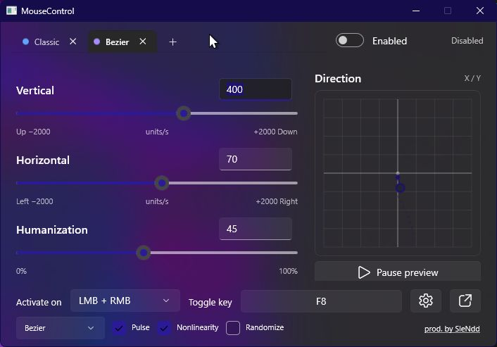
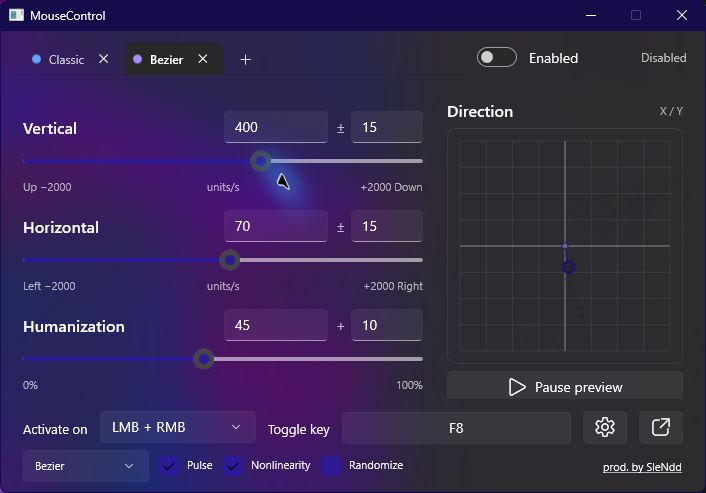
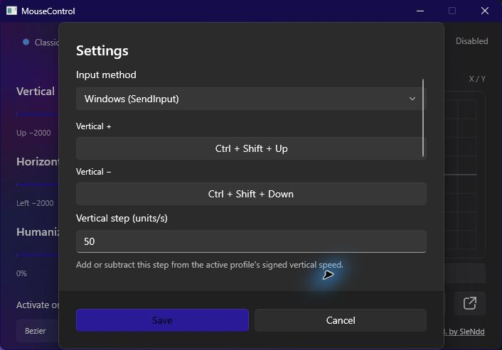
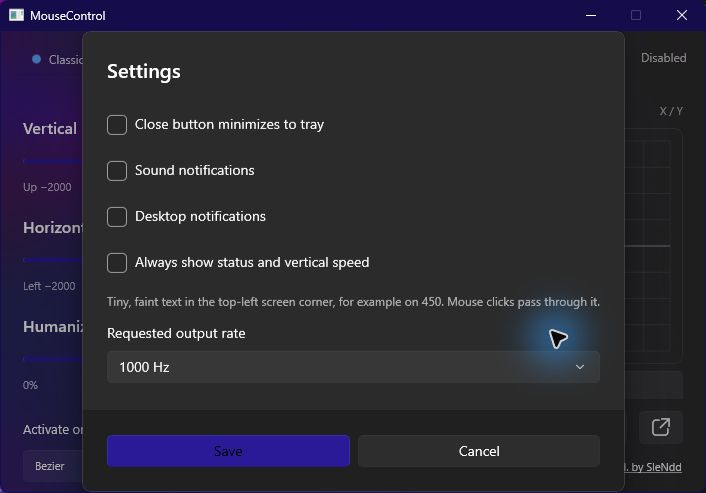

# Screenshots

Current **v0.5.1** interface, captured with isolated example profiles and simulated output.
These are window captures, not mockups. Windows dark appearance and the system accent color
are shown; the example settings are not a complete list of defaults.

## Motion controls



## Randomize

The base value remains editable. The second field specifies a symmetric axis spread or an
upward Humanization spread.



## Input and hotkeys



## Feedback and output rate



## Updating captures

Use the current code and an isolated profile folder. The existing Debug UI-check mode uses
simulated output:

```powershell
dotnet build src/MouseControl.App/MouseControl.App.csproj -c Debug
$env:MOUSECONTROL_SMOKE_DATA_FOLDER = "$PWD\artifacts\screenshot-profiles"
.\src\MouseControl.App\bin\Debug\net10.0-windows10.0.19041.0\win-x64\MouseControl.App.exe --ui-check
```

Capture only the application window, use neutral profile names and verify that no other
windows or personal data appear. Replace the images when visible controls change.
